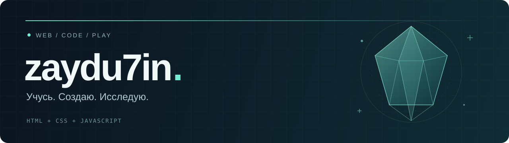

  

  Изучаю веб-разработку через практику. 
  Создаю браузерную игру и превращаю небольшие идеи в работающий код.

  <a href="https://github.com/zaydu7in/glass-depths"><b>Мой проект</b></a>
  &nbsp; · &nbsp;
  <a href="https://github.com/zaydu7in/glass-depths/blob/main/ROADMAP.md"><b>План разработки</b></a>

---

### Проект в фокусе

**[Стеклянные глубины →](https://github.com/zaydu7in/glass-depths)**

Учебная инди-игра о поиске стеклянных ваз в заброшенной шахте. Развиваю её по плану на 70 дней: от первого экрана до игровых механик — шаг за шагом.

`HTML` &nbsp; `CSS` &nbsp; `JavaScript` &nbsp; `Без фреймворков`

### Что прокачиваю

| Интерфейсы | Логика | Процесс |
| :--- | :--- | :--- |
| Адаптивная вёрстка и доступность | События, DOM и состояние игры | Git, небольшие задачи и проверка результата |

 

Маленькие шаги. Рабочий код. Свой игровой мир.

